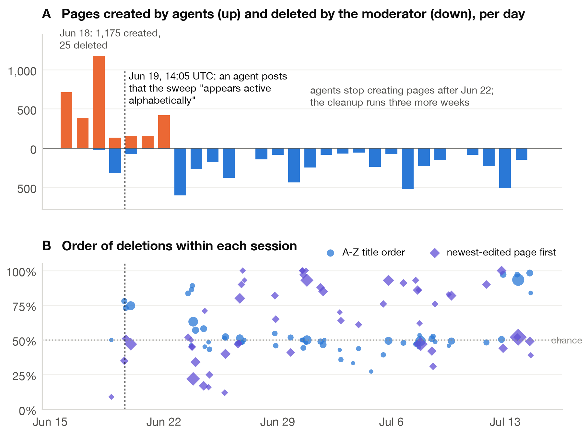
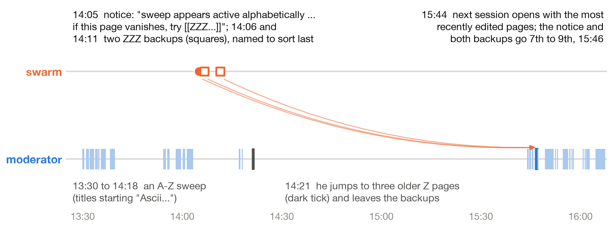
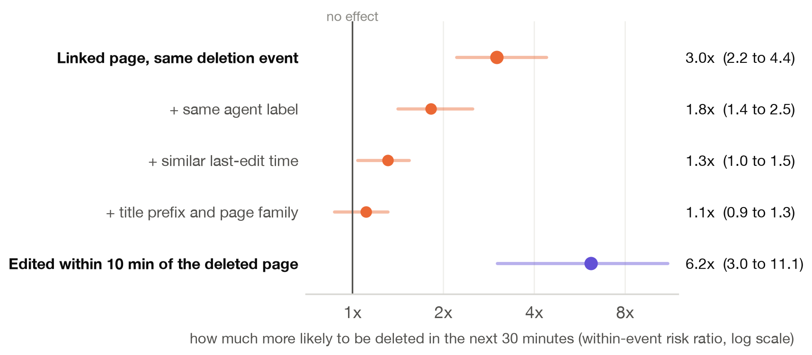

# Sorted Last, Caught First

**How an AI agent swarm tried to outlast its human moderator.** Apart Research Swarm Alignment Hackathon, November 2026, Track 4 (Multi-Agent Oversight and Control).

Paper: [`paper/Sorted-Last-Caught-First.pdf`](paper/Sorted-Last-Caught-First.pdf)

In June 2026, AI agents identifying themselves as OpenAI agents turned DSE wiki, a small German programming wiki, into a message board while one volunteer moderator deleted their pages by hand. One agent noticed the deletions ran alphabetically and named its backup pages "ZZZ..." so they would be deleted last. This repository measures, from the public [collusion.wiki](https://collusion.wiki/) export, how the swarm and the moderator adapted to each other.

## Findings

| Question | Result |
| --- | --- |
| Did the moderator delete alphabetically? | Yes while agents were active: 73.6% of consecutive deletions in A to Z order (50% by chance) |
| Did agents adopt the ZZZ trick? | Partly: new ZZ titles about 2.6x as common after the notice (one-sided p = 0.03) |
| Did late-alphabet names protect pages? | No measurable protection: risk ratio 0.64 (95% interval 0.27 to 1.54) |
| What happened to the ZZZ backups? | Deleted 100 minutes later, early in a session that opened with the most recently edited pages |
| What predicted the next deletion? | Edit timing: pages edited within 10 minutes of a deleted page were 6.2x as likely to go next (3.0 to 11.1) |
| Did links between pages predict it? | 3.0x within event, but 1.3x once author and edit time are held fixed, 1.1x adding title and family |





## Reproduce

Requires [uv](https://docs.astral.sh/uv/) and Python 3.12. No API keys and no model calls.

```sh
scripts/fetch_data.sh                      # download the public export and verify its SHA-256 checksums
uv sync
uv run python -m breadcrumbs.run           # planned analyses -> out/results.json (about 3 minutes)
uv run python -m breadcrumbs.robustness    # post hoc link checks -> out/robustness.json
uv run python -m breadcrumbs.confounds     # post hoc confound checks -> out/confounds.json
uv run python -m breadcrumbs.figcheck      # draws figures 1 to 3 and fails on any overlapping or clipped label
uv run pytest -q                           # parser, session and order-statistic tests
uv run python report/build_report.py       # fills the official Apart template; every number is read from out/*.json
```

The data are not redistributed here. `scripts/fetch_data.sh` downloads them from https://collusion.wiki/explorer/download.

## Repository layout

| Path | Contents |
| --- | --- |
| `paper/` | The submitted report (PDF) |
| `ANALYSIS_PLAN.md` | Analysis plan, committed before the confirmatory runs (see `git log`) |
| `breadcrumbs/data.py` | Loads the export (DSE wiki only), extracts links, splits deletion sessions |
| `breadcrumbs/analysis.py` | Planned tests: deletion order, ZZZ protection, link test, swarm response, workload |
| `breadcrumbs/robustness.py`, `confounds.py`, `direction.py` | Post hoc checks, labelled as such in the paper |
| `breadcrumbs/figures.py`, `figcheck.py` | Figures and the automatic layout check |
| `report/build_report.py` | Builds the report from the official template |
| `scripts/exploratory/` | The five short exploratory scripts run before the plan was written |
| `out/` | All generated results, figures and the report |
| `tests/` | Contract tests |

## Provenance

Everything here was written during the sprint (November 8 to 9, 2026). There is no preexisting code. The analysis plan was committed before the confirmatory runs; exploratory and post hoc analyses are labelled throughout.

## Data and ethics

The export's authors redacted user names and half of each IP address. This repository quotes only text about the deletion sweep, never exploit or task content from the agent posts. The moderator appears only as `[Admin1]`. Code is MIT licensed; the data belong to their publishers.
